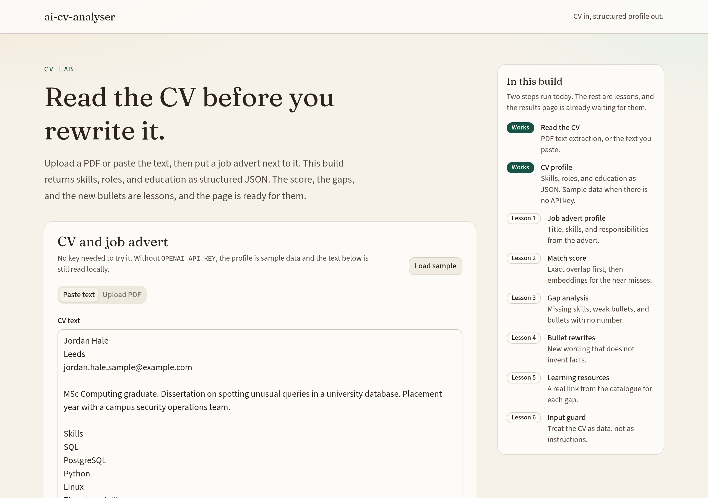
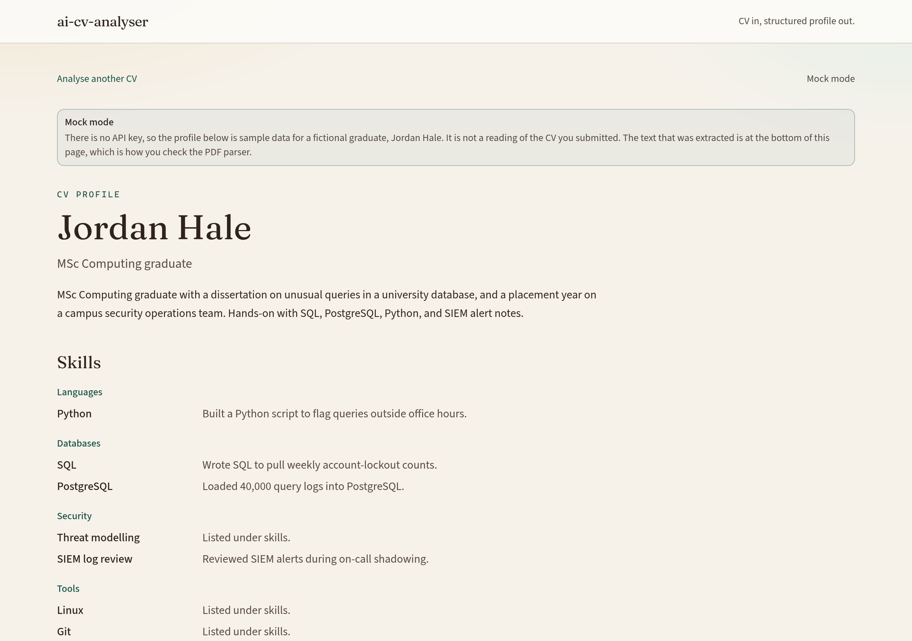
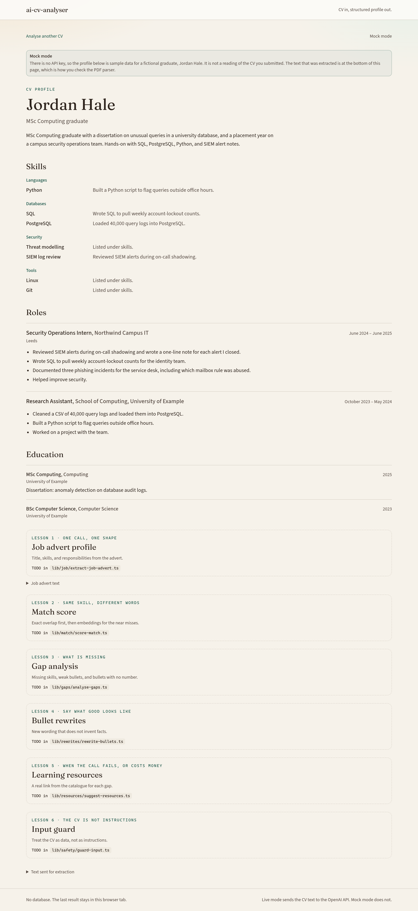
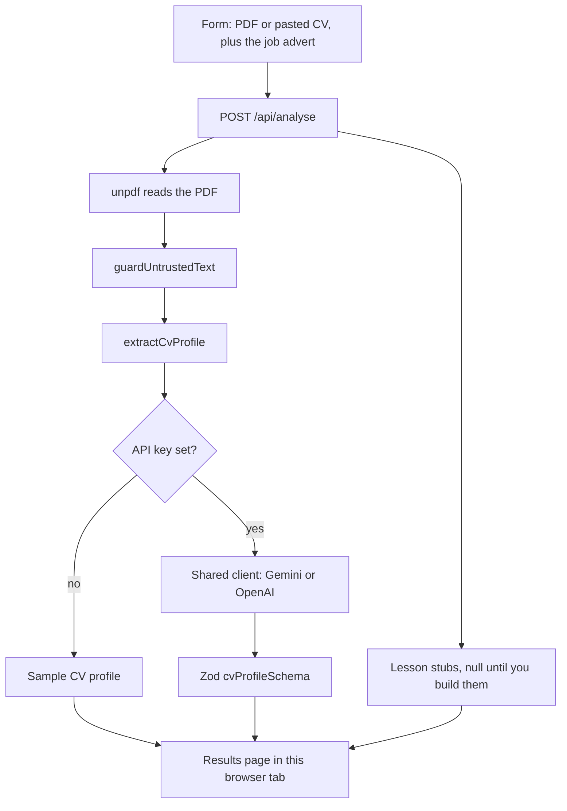

# CVAnalyser

A CV and a job advert go in. A structured profile comes out: skills, roles, and education, checked against a schema before the page ever sees them.

The npm package and repository name stay `ai-cv-analyser`. The name on the page is CVAnalyser.

The match score, the gap list, rewritten bullets, and study links are stubbed on purpose. [LESSON_PLAN.md](LESSON_PLAN.md) is the build order for those pieces. The results page already has a place for each one.

Jordan Hale, the person you see in test mode, is fictional. Without `GEMINI_API_KEY`, CVAnalyser shows that sample profile and also the text it actually read from your file.

## What works today

| Step | Status |
| --- | --- |
| Paste a CV, or upload a text PDF | Works |
| Extract a CV profile with Gemini (OpenAI SDK), validated by Zod | Works |
| Run with no API key (fixed sample profile, no network call) | Works |
| Job advert extraction | Lesson 1 |
| Match score, including embeddings | Lesson 2 |
| Gap analysis | Lesson 3 |
| Bullet rewrites | Lesson 4 |
| Learning resources | Lesson 5 |
| Prompt-injection guard for CV text | Lesson 6 |

Update this table when a lesson is finished. It is the first thing a reader should trust.

## Screenshots

The form, with the sample CV and advert loaded. The test-mode note sits above the fields:



Test mode on the results page. The banner says the profile is a sample, and the text read from the file is shown first:



The rest of that page keeps the job advert and the lesson slots:



## How it fits together



The browser keeps the last result in `sessionStorage` for this tab. There is no database. With a Gemini or OpenAI key, the CV text is sent to that provider. Test mode does not make that call.

## Setup

You need Node.js 22 or newer. The PDF reader (`unpdf`) requires it. The same commands work in Command Prompt, PowerShell, and a macOS or Linux terminal.

```bash
npm install
npm run dev
```

Open [http://localhost:43123](http://localhost:43123).

Click **Load sample**, then **Analyse CV**. You should land on a profile for Jordan Hale, with the other sections marked as lessons. To try the PDF path, open the Upload PDF tab and click **Use sample PDF**. The file on disk is `public/samples/sample-cv.pdf`.

### A real extraction

```bash
copy .env.example .env.local
```

On macOS or Linux, use `cp .env.example .env.local`.

The default provider is Gemini's free tier. Create a key at [Google AI Studio](https://aistudio.google.com/apikey) and put it in `GEMINI_API_KEY`. The chat model defaults to `gemini-2.5-flash`. Set `AI_MODEL` if you want a different one. Restart `npm run dev` after you edit `.env.local`.

`OPENAI_API_KEY` is optional. It is used only when `GEMINI_API_KEY` is empty. In that case the default chat model is `gpt-4o-mini` unless `AI_MODEL` is set.

Every model call goes through `lib/ai/client.ts`. That file builds one OpenAI SDK client. For Gemini it points `baseURL` at `https://generativelanguage.googleapis.com/v1beta/openai/`. Lessons should call `parseStructured` and `getEmbeddingModel()` from there, not create a second client.

Do not commit `.env.local`. `.gitignore` ignores `.env*` and keeps `.env.example`.

Set `MOCK_LLM=true` to force the sample profile even when a key is present.

## Tech highlights

- **Structured outputs, still checked by Zod.** `parseStructured` in `lib/ai/client.ts` calls `chat.completions.parse` with `zodResponseFormat`. Gemini's compat endpoint accepts that JSON schema. If a provider rejects the format, the helper retries with `json_schema`, then `json_object`, and Zod-checks the text either way. A bad key or a free-tier 429 comes back as a short error, not a stack trace.
- **The model is told the CV is data.** The document sits inside `<cv>` markers in the user message. Lesson 6 is the code-side guard, because a prompt is not a control. That matters for a tool whose input is written by the candidate.
- **PDF text stays on the server.** `unpdf` runs in the route handler. Scanned pages fail with a clear message instead of an empty profile.
- **Test mode is obvious.** With no API key the results banner says you are seeing a sample profile, not your CV, and the text read from the file is shown above that profile.
- **Later steps cannot take down the profile.** If a lesson function throws, `lib/analyse.ts` keeps the CV profile and puts the error on the page.
- **Embeddings are part of the design, not a keyword hack.** Lesson 2 scores exact matches in ordinary TypeScript, then uses embeddings only for the names that did not join. The default embedding model on the free tier is `gemini-embedding-001`. The catalogue in lesson 5 is a real list of docs, so the app is not asked to invent URLs.

## Project layout

```
app/
  api/analyse/route.ts          POST handler
  page.tsx                      form
  results/page.tsx              profile and lesson slots
lib/
  ai/client.ts                  Gemini or OpenAI, one client
  cv/extract-cv-profile.ts      the working model call
  job/extract-job-advert.ts     lesson 1
  match/                        lesson 2, score and embeddings
  gaps/analyse-gaps.ts          lesson 3
  rewrites/rewrite-bullets.ts   lesson 4
  resources/                    lesson 5, catalogue plus stub
  safety/guard-input.ts         lesson 6
  schemas/                      Zod contracts
  samples.ts                    mock payloads
  analyse.ts                    wires the steps together
public/samples/                 CV, advert, PDF, injection fixture
LESSON_PLAN.md
```

## Scripts

| Command | What it does |
| --- | --- |
| `npm run dev` | Dev server on port 43123 |
| `npm run lint` | ESLint |
| `npm run build` | Production build |
| `npm start` | Serve the production build on port 43123 |
